# REWRITE_ROADMAP.md — Modernization & Best Practices Checklist

## 1. Executive Summary & App Domain

> [!IMPORTANT]
> **PRE-DEVELOPMENT / LOCAL-ONLY CONTEXT (CLEAN SLATE REFACTOR)**:
> This application is strictly in **pre-development and running locally**. There are **no production databases, no active users, and no legacy data to preserve**. 
> Future agents and developers have complete freedom to:
> - Rethink or redesign database schemas from scratch (no complex data migration steps needed).
> - Completely tear down and replace Flask endpoints, database helpers, and WebSocket handlers with clean FastAPI primitives.
> - Overhaul frontend state, component hierarchies, or routing without backward-compatibility friction.

**Post Season Fantasy** (`postsznfantasy`) is a niche fantasy football platform for the NFL playoffs. 
Unlike standard season-long leagues that conclude at Week 18, postseason fantasy leagues run through four knockout playoff rounds:
1. **Wild Card Round**
2. **Divisional Round**
3. **Conference Championships**
4. **Super Bowl**

### Core Mechanics & User Journey
- **Roster & Elimination Mechanics**: League members draft players from playoff-bound NFL teams. When an NFL team is eliminated, its players can no longer accumulate fantasy points. A team owner's success depends both on player performance and predicting which NFL teams will advance deep into February.
- **League Creation & Granular Customization**: Commissioners configure league size (e.g., 4–16 teams), roster composition (QB, RB, WR, TE, Flex, K, DST, Bench), and extensive custom scoring rules across passing, rushing, receiving, carrying/turnovers, kicking distance brackets, and defensive scoring events.
- **Real-Time Snake Draft**: A synchronized draft room with live pick timers, round-by-round draft matrices, searchable/position-filtered player selection, and auto-pick fallback.
- **Playoff Standings & Player Survival**: A dashboard breaking down team scoring by playoff round alongside a live count of active "players remaining".
- **Player Database & External Stats Ingestion**: Synchronization of NFL teams, player rosters, and game box scores sourced via external sports APIs (RapidAPI NFL endpoints).

---

## 2. Current State vs. Target State Comparison

```mermaid
flowchart TD
    subgraph Current_Legacy_State ["Current Legacy State (Paused)"]
        PKG_OLD["pip + requirements.txt<br/>(Flat, unpinned)"]
        F_OLD["Flask 3 + Blueprints<br/>(Synchronous)"]
        LINT_PY_OLD[".flake8<br/>(No auto-formatter, no mypy)"]
        WS_OLD["Flask-SocketIO<br/>(Engine.IO / Socket.IO)"]
        DB_OLD["Flask-SQLAlchemy + Raw psycopg2<br/>(Imperative setup.py DDL)"]
        AUTH_OLD["Firebase Admin<br/>(@token_required wrapper)"]
        FE_OLD["React 18 + Vite<br/>(45 TS Build Errors, react-table v7)"]
        FE_LINT_OLD["ESLint 8 + .eslintrc.cjs<br/>(Slow, 47 warnings/errors)"]
        DATA_OLD["requests + requests-cache<br/>(Stubbed random scoring)"]
    end

    subgraph Target_Modern_State ["Target Modern Architecture (FastAPI + React)"]
        PKG_NEW["uv + pyproject.toml<br/>(uv.lock, sub-second resolution)"]
        F_NEW["FastAPI + APIRouter<br/>(Asynchronous ASGI)"]
        LINT_PY_NEW["Ruff + Mypy<br/>(Format, lint & strict typing in pyproject.toml)"]
        WS_NEW["Native FastAPI WebSockets<br/>(RFC 6455 + ConnectionManager)"]
        DB_NEW["SQLAlchemy 2.0 / SQLModel<br/>(Alembic Migrations)"]
        AUTH_NEW["FastAPI Depends()<br/>(Dependency Injection + Auth Bearer)"]
        FE_NEW["React 18/19 + Vite<br/>(Strict TS, TanStack Table v8, Clean Context)"]
        FE_LINT_NEW["Biome<br/>(biome.json, instant formatting & linting)"]
        DATA_NEW["httpx async client<br/>(Deterministic scoring engine)"]
    end

    Current_Legacy_State ==>|Modern Agentic Rewrite| Target_Modern_State
```

---

## 3. Checklist of Modern Agentic Coding Best Practices

This checklist outlines the sequence of refactor tasks for developers and AI coding agents to elevate this repository into a maintainable, high-performance, production-ready system.

> **Engineering Guiding Light**:
> - **KISS**: Write the simplest code that solves the problem. Eliminate speculative features or needless layers of indirection.
> - **Comment Minimization & Intent**: Code explains *what*; comments are reserved strictly for *why* (non-obvious domain rules, hardware/protocol constraints, bug workarounds). If code needs a comment to explain what it does, refactor and rename first.

### Phase 1: Environment, Tooling & Modern Packaging
- [ ] **Migrate Backend Packaging to `uv` & `pyproject.toml`**:
  - [ ] Initialize `pyproject.toml` using `uv` to manage Python 3.13 dependencies and workspaces.
  - [ ] Migrate dependencies from `api/requirements.txt` to `pyproject.toml` with pinned semver constraints.
  - [ ] Generate deterministic lockfile `uv.lock` via `uv lock`.
  - [ ] Retire legacy virtual environment scripts in favor of `uv run` and `uv sync`.
- [ ] **Configure Ruff (Format & Lint) & Mypy**:
  - [ ] Configure `[tool.ruff]` in `pyproject.toml` with line-length 88 and target version `py313`.
  - [ ] Enable rulesets: `E` (Pycodestyle errors), `F` (Pyflakes), `I` (isort imports), `B` (flake8-bugbear), `UP` (pyupgrade).
  - [ ] Configure `[tool.ruff.format]` to eliminate manual styling divergence.
  - [ ] Deprecate `.flake8`.
  - [ ] Configure `[tool.mypy]` in `pyproject.toml` with `strict = true`, `disallow_untyped_defs = true`, and Pydantic plugin.
- [ ] **Migrate Frontend Tooling to Biome (`biome.json`)**:
  - [ ] Install `@biomejs/biome` in `frontend/package.json`.
  - [ ] Initialize `frontend/biome.json` configured for React 18/TypeScript with:
    - Code formatter (spaces, 2 indents, 80-100 column limit).
    - Linter with recommended rules enabled.
    - Automatic import sorting (`organizeImports`).
  - [ ] Replace ESLint npm scripts in `frontend/package.json`:
    - `"lint": "biome check src/"`
    - `"format": "biome format src/ --write"`
    - `"check": "biome check --write src/"`
  - [ ] Remove `.eslintrc.cjs` and redundant ESLint plugins (`eslint`, `@typescript-eslint/*`, `eslint-plugin-react-hooks`, `eslint-plugin-react-refresh`).
- [ ] **Standardize Environment Configuration**:
  - [ ] Add `.env.example` in repo root and `frontend/` documenting all required secrets:
    - Backend: `PG_URI`, `PG_HOST`, `PG_PORT`, `PG_USER`, `PG_PASSWORD`, `PG_DBNAME`, `FIREBASE_SERVICE_ACCOUNT_KEY_PATH`, `RAPIDAPI_BASEURL`, `RAPIDAPI_APIKEY`, `RAPIDAPI_APIHOST`, `SEASON_YEAR`.
    - Frontend: `VITE_API_URL`, `VITE_WS_URL`, `VITE_FIREBASE_*`.
- [ ] **Fix Blocking Frontend TypeScript Build Errors (`tsc`)**:
  - [ ] Remove unused `React` imports across files to satisfy `noUnusedLocals: true`.
  - [ ] Export and import `Team` and `DraftPick` interfaces in `frontend/src/components/draft/DraftBoard.tsx`.
  - [ ] Fix implicit `any` types in `PlayerSelector.tsx`, `PlayersTable.tsx`, and `CreateLeaguePage.tsx`.
  - [ ] Replace untyped `react-table` import with proper declaration or upgrade to `@tanstack/react-table`.
  - [ ] Add index signature to `expanded` state in `CreateLeaguePage.tsx` (`[key: string]: boolean`).
- [ ] **Local Containerization**:
  - [ ] Create `docker-compose.yml` defining PostgreSQL 16 with healthchecks and a volume mount for local development.

---

### Phase 2: FastAPI Backend Migration
- [ ] **Application Skeleton & ASGI Setup**:
  - [ ] Initialize FastAPI app with `lifespan` context manager for startup/shutdown events (replacing global module side-effects).
  - [ ] Replace Flask blueprints with modular `APIRouter` instances:
    - `api/routers/auth.py` (User onboarding & token exchange)
    - `api/routers/leagues.py` (League CRUD, settings, teams)
    - `api/routers/drafts.py` (Draft status, pick submission, draft state)
    - `api/routers/players.py` (Player directory, season & playoff stats)
    - `api/routers/admin.py` (Ingestion & DB management)
- [ ] **Eliminate Fatal Import-Time Side Effects**:
  - [ ] Refactor Firebase Admin SDK initialization into a lazy dependency provider (`get_firebase_app`).
  - [ ] Remove `conn: connection = get_pg_connection()` default arguments in `setup.py`, `update.py`, and `pg_utils.py`.
- [ ] **Dependency Injection & Authentication**:
  - [ ] Implement `get_current_user` using `fastapi.security.HTTPBearer` and `Depends()` to extract and verify Firebase tokens.
  - [ ] Implement `get_db` session dependency for scoped database transactions with auto-rollback on exception.
- [ ] **Type Rigor & Schema Validation**:
  - [ ] Define comprehensive Pydantic v2 schemas for all request payloads (`LeagueCreate`, `DraftPickSubmit`, etc.) instead of unchecked `request.json`.
  - [ ] Standardize API response models using `response_model=...` and camelCase serialization (`BaseSchema`).
- [ ] **Native WebSocket Draft Room**:
  - [ ] Replace `flask-socketio` with native FastAPI WebSocket endpoint (`@router.websocket("/ws/draft/{league_id}")`).
  - [ ] Implement a thread-safe `DraftConnectionManager` to broadcast pick events, clock ticks, and draft state to connected clients.
- [ ] **Bug Fixes in Existing Endpoints**:
  - [ ] Fix `draft_routes.py` `get_draft_picks` to query all picks for the draft and return the actual list rather than unassigned variable `draft`.

---

### Phase 3: Database & Migration Architecture
- [ ] **Modern SQLAlchemy 2.0 / SQLModel Setup**:
  - [ ] Migrate models from legacy `db.Model` syntax to SQLAlchemy 2.0 `DeclarativeBase` with typed mapped columns (`Mapped[int] = mapped_column(...)`).
  - [ ] Disambiguate duplicate `Standings` model (previously defined in both ORM models and Pydantic schemas).
- [ ] **Automated Migrations with Alembic**:
  - [ ] Initialize Alembic (`alembic init alembic`) with `env.py` pointing to the unified declarative metadata.
  - [ ] Generate initial revision from current schema and deprecate raw DDL strings in `api/utils/db/setup.py`.
- [ ] **Relational Integrity**:
  - [ ] Configure proper foreign key cascades (`ondelete="CASCADE"`) between Leagues, Teams, Drafts, and DraftPicks.

---

### Phase 4: Business Logic & Ingestion Engine
- [ ] **Deterministic Fantasy Scoring Engine**:
  - [ ] Replace stubbed `calculate_player_points` in `api/utils/calculations/fantasy_points_utils.py` with an evaluator that parses player box scores against active `LeagueSettings`.
  - [ ] Cover fractional scoring for passing/rushing/receiving yards, turnover penalties, kicker yardage tiers, and defensive scoring events.
- [ ] **Playoff Elimination & Survival Logic**:
  - [ ] Replace `random.randint` in `get_players_left` with a query against `NFLTeam.is_active` to count remaining rostered players.
  - [ ] Replace `random.uniform` in `get_team_fantasy_points_by_week` with real point summation per playoff round.
- [ ] **Resilient NFL Stats Ingestion Client**:
  - [ ] Refactor `RapidApi` client to use `httpx.AsyncClient` with configurable retry policies (`tenacity`) and rate limiting.
  - [ ] Implement real update logic in `api/utils/db/update.py` for game schedules, box scores, and active team rosters.

---

### Phase 5: Frontend Refactor & State Synchronization
- [ ] **Unified Auth & User Context**:
  - [ ] Wire `frontend/src/contexts/UserContext.tsx` directly into the Firebase `onAuthStateChanged` stream in `App.tsx`.
  - [ ] Fix `CreateLeaguePage.tsx` to properly destructure `const { userId } = useUser();`.
- [ ] **Complete Missing Views**:
  - [ ] Implement `frontend/src/pages/TeamPage.tsx` to render a user's roster, player statuses, and lineup positions.
  - [ ] Implement `frontend/src/pages/SettingsPage.tsx` and fill empty `LeagueInfo.tsx` (0 bytes).
- [ ] **Draft Room WebSocket Client Alignment**:
  - [ ] Update `frontend/src/hooks/useWebSocket.ts` to connect to standard FastAPI WebSocket (`ws://<backend>/ws/draft/<league_id>`) with reconnection backoff and heartbeat.
  - [ ] Align message schema with backend broadcast events (`PICK_MADE`, `TIMER_UPDATE`, `DRAFT_COMPLETE`).
- [ ] **Fix Endpoint Routing**:
  - [ ] Correct API path in `DraftPage.tsx` line 144 from `/api/draft-info/${leagueId}` to `/api/draft/draft-info/${leagueId}` (or FastAPI equivalent).
- [ ] **Modern Table Migration**:
  - [ ] Migrate `PlayersTable.tsx` to `@tanstack/react-table` v8 for type-safe column definitions, virtualization, and position filtering.

---

### Phase 6: Testing, Observability & CI Pipeline
- [ ] **Backend Test Suite**:
  - [ ] Add `pytest` and `pytest-asyncio` using `uv add --dev pytest pytest-asyncio`.
  - [ ] Write unit tests for scoring calculation logic across various scoring configurations.
  - [ ] Write integration tests for league creation, draft picks, and authentication checks using `httpx.AsyncClient`.
- [ ] **Frontend Test Suite**:
  - [ ] Configure `vitest` and `@testing-library/react` for component and hook testing (`useWebSocket`, `Countdown`).
- [ ] **Automated CI Workflow (`.github/workflows/ci.yml`)**:
  - [ ] Python Job:
    - [ ] `uv sync --frozen`
    - [ ] `uv run ruff check .`
    - [ ] `uv run ruff format --check .`
    - [ ] `uv run mypy api/`
    - [ ] `uv run pytest`
  - [ ] Frontend Job:
    - [ ] `npm ci`
    - [ ] `npx @biomejs/biome check src/`
    - [ ] `npm run build`
    - [ ] `npm run test`
