# REWRITE_ROADMAP.md — Modernization & Best Practices Checklist

## 1. Executive Summary & App Domain

> [!IMPORTANT]
> **PRE-DEVELOPMENT / LOCAL-ONLY CONTEXT (CLEAN SLATE REFACTOR)**:
> This application is strictly in **pre-development and running locally**. There are **no production databases, no active users, and no legacy data to preserve**. 
> Future agents and developers have complete freedom to:
> - Rethink or redesign database schemas from scratch (no complex data migration steps needed).
> - Completely tear down and replace Flask endpoints, database helpers, and WebSocket handlers with clean FastAPI primitives.
> - Overhaul frontend state, component hierarchies, or routing without backward-compatibility friction.

**PostSzn Fantasy** (`postsznfantasy`) is a niche fantasy football platform for the NFL playoffs. 
Unlike standard season-long leagues that conclude at Week 18, postseason fantasy leagues run through four knockout playoff rounds:
1. **Wild Card Round**
2. **Divisional Round**
3. **Conference Championships**
4. **Super Bowl**

### Core Mechanics & User Journey
- **Roster & Elimination Mechanics**: League members draft players from playoff-bound NFL teams. When an NFL team is eliminated, its players can no longer accumulate fantasy points. A team owner's success depends both on player performance and predicting which NFL teams will advance deep into February.
- **League Creation & Granular Customization**: Commissioners configure league size (e.g., 4–16 teams), roster composition (QB, RB, WR, TE, Flex, K, DST, Bench), and extensive custom scoring rules across passing, rushing, receiving, carrying/turnovers, kicking distance brackets, and defensive scoring events.
- **Real-Time Snake Draft**: A synchronized draft room with live pick timers, round-by-round draft matrices, searchable/position-filtered player selection, and auto-pick fallback.
- **Playoff Standings & Player Survival**: A dashboard breaking down team scoring by playoff round alongside a live count of active "players remaining".
- **Player Database & External Stats Ingestion**: Synchronization of NFL teams, player rosters, and game box scores sourced via external sports APIs (RapidAPI NFL endpoints).

---

## 2. Current State vs. Target State Comparison

```mermaid
flowchart TD
    subgraph Current_Legacy_State ["Current Legacy State (Paused)"]
        PKG_OLD["pip + requirements.txt<br/>(Flat, unpinned)"]
        F_OLD["Flask 3 + Blueprints<br/>(Synchronous)"]
        LINT_PY_OLD[".flake8<br/>(No auto-formatter, no mypy)"]
        WS_OLD["Flask-SocketIO<br/>(Engine.IO / Socket.IO)"]
        DB_OLD["Flask-SQLAlchemy + Raw psycopg2<br/>(Imperative setup.py DDL)"]
        AUTH_OLD["Firebase Admin<br/>(@token_required wrapper)"]
        FE_OLD["React 18 + Vite<br/>(45 TS Build Errors, react-table v7)"]
        FE_LINT_OLD["ESLint 8 + .eslintrc.cjs<br/>(Slow, 47 warnings/errors)"]
        DATA_OLD["requests + requests-cache<br/>(Stubbed random scoring)"]
    end

    subgraph Target_Modern_State ["Target Modern Architecture (FastAPI + React)"]
        PKG_NEW["uv + pyproject.toml<br/>(uv.lock, sub-second resolution)"]
        F_NEW["FastAPI + APIRouter<br/>(Asynchronous ASGI)"]
        LINT_PY_NEW["Ruff + Mypy<br/>(Format, lint & strict typing in pyproject.toml)"]
        WS_NEW["Native FastAPI WebSockets<br/>(RFC 6455 + ConnectionManager)"]
        DB_NEW["SQLAlchemy 2.0 / SQLModel<br/>(Alembic Migrations)"]
        AUTH_NEW["FastAPI Depends()<br/>(Dependency Injection + Auth Bearer)"]
        FE_NEW["React 18/19 + Vite<br/>(Strict TS, TanStack Table v8, Clean Context)"]
        FE_LINT_NEW["Biome<br/>(biome.json, instant formatting & linting)"]
        DATA_NEW["httpx async client<br/>(Deterministic scoring engine)"]
    end

    Current_Legacy_State ==>|Modern Agentic Rewrite| Target_Modern_State
```



---

## 3. Checklist of Modern Agentic Coding Best Practices

This checklist outlines the sequence of refactor tasks for developers and AI coding agents to elevate this repository into a maintainable, high-performance, production-ready system.

> **Engineering Guiding Light**:
> - **KISS**: Write the simplest code that solves the problem. Eliminate speculative features or needless layers of indirection.
> - **Comment Minimization & Intent**: Code explains *what*; comments are reserved strictly for *why* (non-obvious domain rules, hardware/protocol constraints, bug workarounds). If code needs a comment to explain what it does, refactor and rename first.

### Phase 1: Environment, Tooling & Modern Packaging
- [x] **Migrate Backend Packaging to `uv` & `pyproject.toml`**:
  - [x] Initialize `api/pyproject.toml` using `uv` to manage Python 3.13 dependencies.
  - [x] Migrate dependencies from `api/requirements.txt` to `api/pyproject.toml` with pinned semver constraints and delete `requirements.txt`.
  - [x] Generate deterministic lockfile `api/uv.lock` via `uv lock`.
  - [x] Retire legacy virtual environment scripts in favor of `uv run` and `uv sync` in `api/`.
- [x] **Configure Ruff (Format & Lint) & Mypy**:
  - [x] Configure `[tool.ruff]` in `api/pyproject.toml` with line-length 88 and target version `py313`.
  - [x] Enable rulesets: `E` (Pycodestyle errors), `F` (Pyflakes), `I` (isort imports), `B` (flake8-bugbear), `UP` (pyupgrade).
  - [x] Configure `[tool.ruff.format]` to eliminate manual styling divergence.
  - [x] Deprecate `.flake8`.
  - [x] Configure `[tool.mypy]` in `api/pyproject.toml` with `strict = true`, `disallow_untyped_defs = true`, and Pydantic plugin.
- [x] **Migrate Frontend Tooling to Biome (`biome.json`)**:
  - [x] Install `@biomejs/biome` in `frontend/package.json`.
  - [x] Initialize `frontend/biome.json` configured for React 18/TypeScript with:
    - Code formatter (spaces, 2 indents, 80-100 column limit).
    - Linter with recommended rules enabled.
    - Automatic import sorting (`organizeImports`).
  - [x] Replace ESLint npm scripts in `frontend/package.json`:
    - `"lint": "biome check src/"`
    - `"format": "biome format src/ --write"`
    - `"check": "biome check --write src/"`
  - [x] Remove `.eslintrc.cjs` and redundant ESLint plugins (`eslint`, `@typescript-eslint/*`, `eslint-plugin-react-hooks`, `eslint-plugin-react-refresh`).
- [x] **Standardize Environment Configuration**:
  - [x] Add `.env.example` in `api/` and `frontend/` documenting all required secrets:
    - Backend (`api/.env.example`): `PG_URI`, `PG_HOST`, `PG_PORT`, `PG_USER`, `PG_PASSWORD`, `PG_DBNAME`, `FIREBASE_SERVICE_ACCOUNT_KEY_PATH`, `RAPIDAPI_BASEURL`, `RAPIDAPI_APIKEY`, `RAPIDAPI_APIHOST`, `SEASON_YEAR`.
    - Frontend (`frontend/.env.example`): `VITE_API_URL`, `VITE_WS_URL`, `VITE_FIREBASE_*`.
- [x] **Local Containerization**:
  - [x] Create `docker-compose.yml` defining PostgreSQL 16 with healthchecks and a volume mount for local development.

---

### Phase 2: FastAPI Backend Migration
- [x] **Application Skeleton & ASGI Setup**:
  - [x] Initialize FastAPI app with `lifespan` context manager for startup/shutdown events (replacing global module side-effects).
  - [x] Replace Flask blueprints with modular `APIRouter` instances:
    - `api/routers/auth.py` (User onboarding & token exchange)
    - `api/routers/leagues.py` (League CRUD, settings, teams)
    - `api/routers/drafts.py` (Draft status, pick submission, draft state)
    - `api/routers/players.py` (Player directory, season & playoff stats)
    - `api/routers/admin.py` (Ingestion & DB management)
- [x] **Eliminate Fatal Import-Time Side Effects**:
  - [x] Refactor Firebase Admin SDK initialization into a lazy dependency provider (`get_firebase_app`).
  - [x] Remove `conn: connection = get_pg_connection()` default arguments in `setup.py`, `update.py`, and `pg_utils.py`.
- [x] **Dependency Injection & Authentication**:
  - [x] Implement `get_current_user` using `fastapi.security.HTTPBearer` and `Depends()` to extract and verify Firebase tokens.
  - [x] Implement `get_db` session dependency for scoped database transactions with auto-rollback on exception.
- [x] **Type Rigor & Schema Validation**:
  - [x] Define comprehensive Pydantic v2 schemas for all request payloads (`LeagueCreate`, `DraftPickSubmit`, etc.) instead of unchecked `request.json`.
  - [x] Standardize API response models using `response_model=...` and camelCase serialization (`BaseSchema`).
- [x] **Native WebSocket Draft Room**:
  - [x] Replace `flask-socketio` with native FastAPI WebSocket endpoint (`@router.websocket("/ws/draft/{league_id}")`).
  - [x] Implement a thread-safe `DraftConnectionManager` to broadcast pick events, clock ticks, and draft state to connected clients.
- [x] **Decommission Legacy Flask Architecture**:
  - [x] Purge all legacy Flask packages (`flask`, `flask-sqlalchemy`, `flask-socketio`, `flask-cors`, `flask-bcrypt`) from `pyproject.toml` and `uv.lock`.
  - [x] Delete deprecated Flask application files: `api/app.py`, `api/run.py`, `api/routes/`, and `api/utils/socketio/`.
  - [x] Remove Flask-coupled `token_required` decorator from `api/utils/security/firebase.py`.
  - [x] Add transitional SQLAlchemy `DeclarativeBase` shim in `api/utils/db/models.py` to allow existing ORM models to function without `Flask-SQLAlchemy` pending full Phase 3 rewrite.

---

### Phase 3: Database & Migration Architecture
- [x] **Modern SQLAlchemy 2.0 / SQLModel Setup**:
  - [x] Migrate models from legacy `db.Model` syntax to SQLAlchemy 2.0 `DeclarativeBase` with typed mapped columns (`Mapped[int] = mapped_column(...)`).
  - [x] Disambiguate duplicate `Standings` model (renamed ORM model to `LeagueStanding` to avoid conflict with Pydantic schema).
  - [x] Split monolithic `api/utils/db/models.py` into domain-scoped modules under `api/db/models/` (`user.py`, `league.py`, `draft.py`, `nfl.py`) with a unified `__init__.py` re-exporting all ORM classes.
- [x] **Async Database Session (`api/db/session.py`)**:
  - [x] Replace raw `psycopg2` connections with `asyncpg`-backed `create_async_engine` (dialect `postgresql+asyncpg://`).
  - [x] Production-grade pool config: `pool_size=20`, `max_overflow=10`, `pool_pre_ping=True`, `expire_on_commit=False`.
  - [x] `init_db()` / `close_db()` lifecycle hooks wired into FastAPI `lifespan`; graceful `engine.dispose()` on shutdown.
  - [x] `get_db()` FastAPI dependency: yields `AsyncSession`, auto-commits on success, rolls back on exception.
  - [x] `DbSession = Annotated[AsyncSession, Depends(get_db)]` type alias for clean route injection.
  - [x] Delete `api/utils/db/pg_utils.py`, `api/utils/db/setup.py`, and `api/utils/db/update.py`; thin re-export bridge kept at `api/utils/db/models.py`.
- [x] **Automated Migrations with Alembic**:
  - [x] Initialize Alembic (`alembic init alembic`) with `env.py` pointing to the unified declarative metadata.
  - [x] Generate initial revision from current schema and deprecate raw DDL strings in `api/utils/db/setup.py` (deleted).
- [x] **Relational Integrity**:
  - [x] Configure proper foreign key cascades (`ondelete="CASCADE"`) between Leagues, Teams, Drafts, and DraftPicks.

---

### Phase 3.5: Centralized Configuration with PydanticSettings
- [x] **Add `pydantic-settings` dependency**:
  - [x] Run `uv add pydantic-settings` in `api/` to add `pydantic-settings>=2.7.0` to `pyproject.toml` and regenerate `uv.lock`.
- [x] **Define `Settings` model (`api/core/config.py`)**:
  - [x] Create a single `Settings` class extending `pydantic_settings.BaseSettings` with typed, validated fields for every env var currently scattered across `os.getenv()` call sites:
    ```python
    from pydantic import PostgresDsn
    from pydantic_settings import BaseSettings, SettingsConfigDict

    class Settings(BaseSettings):
        model_config = SettingsConfigDict(env_file=".env", env_file_encoding="utf-8", extra="ignore")

        # Database
        pg_uri: PostgresDsn

        # Firebase
        firebase_service_account_key_path: str

        # RapidAPI
        rapidapi_baseurl: str
        rapidapi_apikey: str
        rapidapi_apihost: str

        # App
        season_year: int = 2025
    ```
  - [x] Use Pydantic's `PostgresDsn` type for `pg_uri` so the connection string is structurally validated at startup rather than failing silently at first query.
  - [x] Declare `season_year` with a typed default so it is optional in `.env` but never arrives as a raw `str`.
- [x] **Expose a cached singleton via `lru_cache`**:
  - [x] Add `get_settings() -> Settings` decorated with `@lru_cache(maxsize=1)` so the `.env` file is parsed exactly once per process and is injectable as `Depends(get_settings)` in any route.
- [x] **Replace all `os.getenv` / `os.environ` call sites**:
  - [x] `api/db/session.py` — database URL passed to `create_async_engine`.
  - [x] Firebase credential provider (`api/utils/security/firebase.py`) — service account key path.
  - [x] `api/utils/rapidapi/rapidapi.py` — RapidAPI base URL, key, and host header.
  - [x] `api/alembic/env.py` — sync DB URL for migrations.
- [x] **Eager validation on startup**:
  - [x] Call `get_settings()` inside the FastAPI `lifespan` before the DB engine is initialized so a missing or malformed var raises a `ValidationError` with a clear field-level message before the server accepts any traffic.
- [x] **Update `.env.example`** to exactly mirror the snake_case field names declared in `Settings` (Pydantic-Settings resolves env vars case-insensitively by default, so `PG_URI` in the shell maps to `pg_uri` on the model).

---

### Phase 4: Business Logic & Ingestion Engine
- [x] **Deterministic Fantasy Scoring Engine**:
  - [x] Replace stubbed `calculate_player_points` in `api/utils/calculations/fantasy_points_utils.py` with an evaluator that parses player box scores against active `LeagueSettings`.
  - [x] Cover fractional scoring for passing/rushing/receiving yards, turnover penalties, kicker yardage tiers, and defensive scoring events.
- [x] **Playoff Elimination & Survival Logic**:
  - [x] Replace `random.randint` in `get_players_left` with a query against `NFLTeam.is_active` to count remaining rostered players.
  - [x] Replace `random.uniform` in `get_team_fantasy_points_by_week` with real point summation per playoff round.
- [x] **Resilient NFL Stats Ingestion Client**:
  - [x] Refactor `RapidApi` client to use `httpx.AsyncClient` with configurable retry policies (`tenacity`) and rate limiting.
  - [x] Implement real update logic in `api/utils/db/update.py` for game schedules, box scores, and active team rosters.

---

### Phase 5: Frontend Refactor & State Synchronization
- [x] **Unified Auth & User Context**:
  - [x] Wire `frontend/src/contexts/UserContext.tsx` directly into the Firebase `onAuthStateChanged` stream in `App.tsx`.
  - [x] Fix `CreateLeaguePage.tsx` to properly destructure `const { userId } = useUser();`.
- [x] **Complete Missing Views**:
  - [x] Implement `frontend/src/pages/TeamPage.tsx` to render a user's roster, player statuses, and lineup positions.
  - [x] Implement `frontend/src/pages/SettingsPage.tsx` and fill empty `LeagueInfo.tsx` (0 bytes).
- [x] **Draft Room WebSocket Client Alignment**:
  - [x] Update `frontend/src/hooks/useWebSocket.ts` to connect to standard FastAPI WebSocket (`ws://<backend>/ws/draft/<league_id>`) with reconnection backoff and heartbeat.
  - [x] Align message schema with backend broadcast events (`PICK_MADE`, `TIMER_UPDATE`, `DRAFT_COMPLETE`).
- [x] **Fix Endpoint Routing**:
  - [x] Correct API path in `DraftPage.tsx` line 144 from `/api/draft-info/${leagueId}` to `/api/draft/draft-info/${leagueId}` (or FastAPI equivalent).
- [x] **Modern Table Migration**:
  - [x] Migrate `PlayersTable.tsx` to `@tanstack/react-table` v8 for type-safe column definitions, virtualization, and position filtering.
- [x] **Frontend TypeScript Hygiene & Build Fixes**:
  - [x] Resolve legacy TypeScript build errors (`DraftBoard`, `CreateLeaguePage`, `PlayerSelector`, `PlayersTable`) to achieve green `npm run build`.

---

### Phase 6: Testing, Observability & CI Pipeline
- [x] **Backend Test Suite**:
  - [x] Add `pytest` and `pytest-asyncio` using `uv add --dev pytest pytest-asyncio`.
  - [x] Write unit tests for scoring calculation logic across various scoring configurations (`tests/test_scoring.py`).
  - [x] Write integration tests for league creation, draft picks, and authentication checks using `httpx.AsyncClient` (`tests/test_api_integration.py`).
- [x] **Frontend Test Suite**:
  - [x] Configure `vitest` and `@testing-library/react` for component and hook testing (`useWebSocket`, `Countdown`).
- [x] **Automated CI Workflow (`.github/workflows/ci.yml`)**:
  - [x] Python Job:
    - [x] `uv sync --frozen`
    - [x] `uv run ruff check .`
    - [x] `uv run ruff format --check .`
    - [x] `uv run mypy .`
    - [x] `uv run pytest`
  - [x] Frontend Job:
    - [x] `npm ci`
    - [x] `npx @biomejs/biome check src/`
    - [x] `npm run build`
    - [x] `npm run test`

---

### Phase 7: Repository Documentation & Developer Experience
- [x] **Core Documentation Overhaul (`README.md`)**:
  - [x] Rewrite root `README.md` to provide full architectural context, high-level system overview, and quickstart instructions.
  - [x] Document prerequisites (Python 3.13+, `uv`, Node.js 20+, Docker Compose, PostgreSQL 16).
  - [x] Provide step-by-step local setup: cloning, `.env` file configuration, DB startup (`docker compose up -d`), backend startup (`uv run uvicorn ...`), and frontend startup (`npm run dev`).
  - [x] Include common troubleshooting tips (database connection, Firebase emulator or credentials setup, seed data).
- [x] **Contribution & Development Standards (`CONTRIBUTING.md`)**:
  - [x] Create `CONTRIBUTING.md` defining branching models, PR guidelines, commit conventions, and definition of done.
  - [x] Detail development standards: KISS principle, self-documenting code, intent-driven comments (documenting *why*, not *what*).
  - [x] Document code quality verification commands for contributors (`uv run ruff check`, `uv run mypy`, `npx @biomejs/biome check`, test runners).
- [x] **Agent & Contributor Context Mapping**:
  - [x] Align `AGENTS.md` and `README.md` cross-references so both human contributors and AI agents have unified domain context, directory maps, and operational workflows.
  - [x] Keep file structures and documentation locations standard and idiomatic (`README.md`, `CONTRIBUTING.md`, `AGENTS.md`, and module-level docs where appropriate) with zero unnecessary fluff.
- [x] **Continuous Agent & Human Documentation Maintenance Rule**:
  - [x] Explicitly mandate in `AGENTS.md` and `CONTRIBUTING.md` that AI agents and human contributors must update documentation whenever modifying architecture, dependencies, endpoints, models, or developer workflows.
  - [x] Establish documentation synchronization as a mandatory checklist item in PR guidelines and agent task-completion protocols (no stale commands, paths, or architectural discrepancies).

---

### Phase 8: Authentication Migration to Supabase Auth
- [x] **Backend Auth Migration (`api/`)**:
  - [x] Replace `firebase-admin` dependency with modern JWT verification (`pyjwt[crypto]` or `authlib`) in `api/pyproject.toml`.
  - [x] Update `api/core/config.py` with Supabase settings (`SUPABASE_URL`, `SUPABASE_JWT_SECRET`, or Supabase JWKS URL) and deprecate Firebase credentials.
  - [x] Refactor `api/dependencies/auth.py` (`get_current_user`) to validate Supabase JWT tokens (verifying issuer, audience, and signature) and extract the Supabase user ID (`sub`) and email.
  - [x] Update database user mapping logic in `api/routers/auth.py` to upsert/resolve `User` records against Supabase identities.
  - [x] Clean up legacy Firebase utilities (`api/utils/security/firebase.py`) and delete stale service account key references.
- [x] **Frontend Auth Migration (`frontend/`)**:
  - [x] Replace `firebase` SDK with `@supabase/supabase-js` in `frontend/package.json`.
  - [x] Create Supabase client instance in `frontend/src/utils/supabase.ts` (or `src/services/supabase.ts`) reading `VITE_SUPABASE_URL` and `VITE_SUPABASE_ANON_KEY`.
  - [x] Refactor `frontend/src/contexts/UserContext.tsx` to subscribe to `supabase.auth.onAuthStateChange` and support Google OAuth (`supabase.auth.signInWithOAuth({ provider: 'google' })`).
  - [x] Update login/logout UI components and remove unused Firebase configuration files (`frontend/src/components/auth/firebase.ts`).
  - [x] Ensure API requests pass the Supabase session access token in the `Authorization: Bearer <token>` header.
- [x] **Setup & Migration Documentation**:
  - [x] Update `README.md` and `AGENTS.md` with step-by-step setup instructions for Supabase Auth:
    - Creating a free Supabase project.
    - Configuring Google OAuth credentials (Google Cloud Console OAuth Client ID & Secret) in the Supabase Dashboard.
    - Setting redirect URLs (`http://localhost:5173`).
    - Configuring `.env` files for both backend and frontend.
  - [x] Update `api/.env.example` and `frontend/.env.example` with the new Supabase environment variables and remove Firebase keys.
  - [x] Update integration tests and mock authentication fixtures in `api/tests/` to use Supabase JWT structure.

---

### Phase 9: SOTA Ingestion Pipeline & Local On-Demand Seeding ("Update-All")
> [!IMPORTANT]
> **CLEAN SLATE INGESTION REFACTOR**: The legacy ingestion code in `api/utils/db/update.py` and old endpoints are throwaway. Build a clean, state-of-the-art ingestion pipeline from scratch using modern async batch upserts (`asyncpg` bulk copy / PostgreSQL `INSERT ... ON CONFLICT DO UPDATE` in bulk chunks), strictly typed Pydantic payloads from RapidAPI, and resilient error recovery.

- [x] **Modern Ingestion Architecture (`api/services/ingestion/`)**:
  - [x] Build a decoupled, typed ingestion service layer:
    - `teams_ingest.py`: Fetches and bulk upserts NFL teams (32 teams in 1 batch).
    - `players_ingest.py`: Fetches and bulk upserts all active NFL players with relations.
    - `season_stats_ingest.py`: Fetches and bulk upserts regular season player stats for drafting/reference.
    - `box_scores_ingest.py`: Fetches playoff game box scores and computes fantasy points deterministically.
  - [x] Use bulk chunked upserts (`execute_values` or multi-row `insert().on_conflict_do_update()`) instead of slow row-by-row iteration.
  - [x] Add caching & rate-limit throttling in `RapidApiClient` to guarantee upstream quotas are protected.
- [x] **Unified "Update-All" CLI Runner (`api/scripts/seed_nfl_data.py`)**:
  - [x] Modern CLI command runnable via `uv run python -m api.scripts.seed_nfl_data`:
    - Flags: `--season 2024`, `--teams-only`, `--players-only`, `--with-stats`, `--force`.
    - Rich formatted console output (timing, records upserted, API quota consumed).
    - Can completely seed a freshly spun-up database container in seconds without touching the browser.
- [x] **On-Demand Admin "Update-All" API Trigger (`api/routers/admin.py`)**:
  - [x] Expose `POST /api/admin/update/all`: Triggers the clean ingestion pipeline in a single async task or background transaction.
  - [x] Returns detailed telemetry: `{"status": "success", "duration_ms": 1420, "synced": {"teams": 32, "players": 1450, "stats": 980}}`.
- [x] **Temporary Dev-Only UI Quick-Sync**:
  - [x] Add an unobtrusive, development-only trigger button (e.g., in a Dev Tools drawer or Settings) to kick off the on-demand update directly from the UI when running locally.
  - [x] Mark with `// DEV-ONLY: Cleanly removable` to be easily pruned prior to production.

---

### Phase 10: PostgreSQL Schema Segregation (Move Off 'public' Schema)
> [!IMPORTANT]
> **REASONABLE SCHEMA DESIGN & CLEAN SLATE**:
> Currently, all application tables are dumped into PostgreSQL's default `public` schema. In modern multi-domain systems, dumping external sports data, league runtime entities, and authentication/user models into `public` causes namespace pollution, privilege confusion, and poor domain separation.
> Since this project is in pre-dev / local-only context with zero legacy migration baggage, we can cleanly segment domain models into dedicated PostgreSQL schemas and configure Alembic + SQLAlchemy to manage them cleanly.

- [ ] **Schema Architecture Decision**:
  - Segregate database objects into clean, domain-scoped PostgreSQL schemas:
    - **`nfl`**: External sports reference data (`nfl_teams`, `nfl_players`, `nfl_player_season_stats`, `nfl_player_game_stats`, `nfl_games`). Keeps large read-heavy ingested datasets isolated.
    - **`fantasy`**: Core application & league runtime state (`users`, `leagues`, `league_settings`, `teams`, `rosters`, `drafts`, `draft_picks`, `league_standings`).
- [ ] **SQLAlchemy ORM Model Updates**:
  - [ ] Add `__table_args__ = {"schema": "nfl"}` to all models in `api/db/models/nfl.py`.
  - [ ] Add `__table_args__ = {"schema": "fantasy"}` to models in `api/db/models/user.py`, `api/db/models/league.py`, and `api/db/models/draft.py`.
  - [ ] Update all foreign key string references with schema qualification (e.g., `ForeignKey("nfl.nfl_teams.id")`, `ForeignKey("fantasy.users.id")`).
- [ ] **Alembic Multi-Schema Configuration**:
  - [ ] Configure `api/alembic/env.py` with `include_schemas=True` and ensure DDL emissions include `CREATE SCHEMA IF NOT EXISTS nfl;` and `CREATE SCHEMA IF NOT EXISTS fantasy;`.
  - [ ] Update or regenerate clean Alembic revision for target multi-schema DDL.
- [ ] **Ingestion & Query Alignment**:
  - [ ] Verify `api/services/ingestion/` bulk upsert queries (`insert()`, `on_conflict_do_update()`) cleanly target schema-qualified tables.
  - [ ] Set `search_path=fantasy,nfl,public` in async database connection pool / engine configuration (`api/db/session.py`) for transparent fallback.
- [ ] **Verification**:
  - [ ] Rebuild local database container cleanly (`docker compose down -v && docker compose up -d`).
  - [ ] Run `uv run alembic upgrade head` and verify `\dn` and `\dt *.*` in psql show zero application tables under `public`.
  - [ ] Run test suite (`uv run pytest`) and seed CLI (`uv run python -m api.scripts.seed_nfl_data --teams-only`) to confirm full end-to-end functionality.

---

### Phase 11: Complete Missing Backend Endpoints & API Contract Alignment
- [ ] **Player Directory & Stats Endpoints (`api/routers/players.py`)**:
  - [ ] `GET /api/players/player-season-stats`: Query `NFLPlayerSeasonStats` joined with `NFLPlayer` and `NFLTeam`, supporting query params `season` and optional `position`. Returns `list[PlayerSeasonStatsResponse]`.
  - [ ] `GET /api/players/player-list`: Query active NFL players with their team information, optionally filterable by `position` and `is_active` NFL teams. Returns `list[Player]`.
  - [ ] Add unit/integration tests for player endpoints in `api/tests/test_api_integration.py`.
- [ ] **Missing League & Team Endpoints (`api/routers/leagues.py`)**:
  - [ ] `GET /api/leagues/{league_id}/teams`: Return all teams participating in the league with team IDs, team names, user/owner details, and draft pick status. (Required by `DraftPage.tsx`).
  - [ ] `GET /api/leagues/teams/{team_id}`: Return detailed team roster, slot assignments, and player playoff survival statuses. (Required by `TeamPage.tsx`).
  - [ ] `PUT /api/leagues/{league_id}/settings`: Allow commissioners to update roster configuration and custom scoring settings. (Required by `SettingsPage.tsx`).
- [ ] **Standings Enrichment**:
  - [ ] Enrich `GET /api/leagues/{league_id}/standings` to include team names and owner display names alongside rank, scores, and active player counts.

---

### Phase 12: Modern Frontend UI/UX Overhaul & Dedicated Landing Experience
- [ ] **Default Route & Dedicated Landing Page (`LandingPage.tsx`)**:
  - [ ] Discontinue using `PlayersPage` as the root (`/`) route.
  - [ ] Build a sleek, modern landing page (`frontend/src/pages/LandingPage.tsx`):
    - **Hero Section**: High-impact playoff football branding explaining the cascading elimination mechanics.
    - **Interactive CTA**: Direct links to "Create a League", "View Your Leagues", or "Join with Code".
    - **How It Works / Rules Explainer**: Visual 4-round progression cards (Wild Card ➔ Divisional ➔ Conference Championships ➔ Super Bowl).
    - **Active User Dashboard Widget**: When authenticated, display the user's active leagues, current standings rank, and next scheduled draft at a glance.
- [ ] **Modern Visual Design System (Shedding "2015 Material UI")**:
  - [ ] Establish a dark-mode-first, sports-centric design theme using modern styling tokens (deep slate/charcoal backgrounds `#0f172a`, vibrant playoff accent colors, glassmorphism cards with subtle border strokes `border-slate-800`, crisp typography).
  - [ ] Replace dated default MUI components (`Paper`, default `AppBar`, boxy dropdowns) with styled, modern components or Tailwind/CSS tokens with sharp border radii, subtle glow/gradient effects, and refined micro-interactions.
  - [ ] Redesign the top navigation header (`App.tsx`):
    - Replace basic white/blue toolbar with a sleek blurred navbar with modern league switcher pill, user profile avatar, and responsive drawer.
- [ ] **Page & Component Refresh**:
  - [ ] **Draft Room (`DraftPage.tsx`, `DraftBoard.tsx`, `PlayerSelector.tsx`)**: Modernize the draft board into an interactive draft grid with live pulsating pick timers, sound/visual cues on deck, and modern search pills.
  - [ ] **Standings Table (`StandingsTable.tsx`)**: Clean data visualization with round-by-round points badges, alive/eliminated player counters, and team avatars.
  - [ ] **Roster View (`TeamPage.tsx`)**: Field or card-based roster view with elimination badges and game status.
  - [ ] **League Creation Flow (`CreateLeaguePage.tsx`)**: Multi-step sleek wizard instead of clunky stacked accordions.

---

## 4. Backlog & Future Enhancements

### Backlog Item 1: Automated Background Data Scheduler (APScheduler / Celery / Event-Driven)
- [ ] **Game-Aware Scheduler**:
  - [ ] Schedule regular season roster syncs (e.g. daily/weekly pre-playoffs).
  - [ ] Implement game-state-driven polling loop during active playoff games (polling RapidAPI box scores every 60–120s only during active game windows, stopping when games conclude).
  - [ ] Auto-detect final game states to trigger team elimination and update playoff survival metrics without manual intervention.

### Backlog Item 2: Standardized Logging Framework (UI & API)
- [ ] **Backend Structured Logging (`api/`)**:
  - [ ] Configure Python standard `logging` / `structlog` via centralized setup in `api/core/logging.py`.
  - [ ] Standardize log output format: JSON in production/containerized environments, colorized human-readable format for local development.
  - [ ] Add FastAPI request logging middleware to track incoming requests, method, path, status code, response time, and correlation/request IDs (`X-Request-ID`).
  - [ ] Integrate contextual logging for key lifecycle and domain events: database connection pool status, WebSocket draft room connection/disconnection/events, RapidAPI ingestion jobs, and auth failures.
  - [ ] Replace any leftover `print()` statements across backend modules with typed logger instances (`logger = logging.getLogger(__name__)`).
- [ ] **Frontend Logging & Telemetry (`frontend/`)**:
  - [ ] Create a lightweight client logging utility (`src/utils/logger.ts`) supporting log levels (`DEBUG`, `INFO`, `WARN`, `ERROR`).
  - [ ] Guard debug/info logs behind environment flags (`import.meta.env.DEV`) to prevent console pollution in production builds.
  - [ ] Instrument WebSocket events in `useWebSocket.ts` (connection states, reconnection attempts, protocol payload mismatches) with clear contextual logs.
  - [ ] Standardize frontend error logging across React Error Boundaries and API fetch wrappers.
