# Database ERD

Entity relationships for the Postgres schema (`fantasy` and `nfl`). The source of truth is the SQLAlchemy models in `api/db/models/`; this diagram is checked against them by `api/tests/test_erd.py`, so update it in the same PR as any model or migration change.

Conventions: entity names are table names without the schema. Tables in `fantasy` are the league game; tables in `nfl` are ingested NFL data. Very wide tables are summarised as column groups (see the notes under the diagram) and are exempt from the per-column check.

```mermaid
erDiagram
    users ||--o{ league_members : "joins"
    leagues ||--o{ league_members : "has"
    leagues ||--|| league_settings : "configured by"
    leagues ||--o| drafts : "has one"
    leagues ||--o{ teams : "has"
    users |o--o{ teams : "owns"
    leagues ||--o{ league_invites : "has"
    users |o--o{ league_invites : "created by"
    drafts ||--o{ draft_picks : "records"
    teams ||--o{ draft_picks : "makes"
    nfl_players ||--o{ draft_picks : "picked as"
    drafts ||--o{ draft_queue : "has"
    teams ||--o{ draft_queue : "queues"
    nfl_players ||--o{ draft_queue : "queued as"
    leagues ||--o{ team_players : "scopes"
    teams ||--o{ team_players : "rosters"
    nfl_players ||--o{ team_players : "rostered as"
    teams ||--o{ lineup_slots : "sets"
    nfl_players ||--o{ lineup_slots : "placed as"
    leagues ||--o{ standings : "ranks"
    teams ||--o{ standings : "ranked as"
    leagues ||--o{ activity_events : "logs"
    teams |o--o{ activity_events : "about"
    users |o--o{ activity_events : "caused by"
    users ||--o{ activity_views : "reads"
    leagues ||--o{ activity_views : "read in"
    nfl_teams ||--o{ nfl_players : "employs"
    nfl_teams ||--o{ nfl_games : "plays home"
    nfl_teams ||--o{ nfl_games : "plays away"
    nfl_players ||--o{ nfl_player_game_stats : "has"
    nfl_players ||--o{ nfl_player_season_stats : "has"
    nfl_games ||--o{ nfl_player_game_stats : "produces"
    nfl_teams ||--o{ depth_chart_starters : "lists"
    nfl_players ||--o{ depth_chart_starters : "starts as"

    users {
        int id PK
        string supabase_uid UK
        string username
        string email UK
    }
    leagues {
        int id PK
        string name
        int season
    }
    league_members {
        int league_id PK,FK
        int user_id PK,FK
        string role
        datetime joined_at
    }
    league_settings {
        int id PK
        int league_id UK,FK
        int number_teams
        int roster_total
        decimal multiplier_wild_card
        string tiebreaker
        bool team_qb
        bool team_k
    }
    league_invites {
        int id PK
        string code UK
        int league_id FK
        int created_by FK
        datetime created_at
        datetime expires_at
        int max_uses
        int uses
        bool revoked
    }
    teams {
        int id PK
        string name
        int owner_id FK
        int league_id FK
    }
    drafts {
        int id PK
        int league_id UK,FK
        string status
        datetime start_time
        string draft_type
        int rounds
        string pick_timeout_action
        datetime pick_started_at
        datetime current_pick_deadline
        int paused_remaining_seconds
        int time_per_pick_seconds
        bool slow_draft_auto_pause
        time slow_draft_pause_from
        time slow_draft_pause_to
        string slow_draft_pause_timezone
        bool cpu_autopick
        bool alphabetical_sort
        int_array draft_order_team_ids
    }
    draft_picks {
        int id PK
        int draft_id FK
        int team_id FK
        int player_id FK
        int number_round
        int number_pick_overall
        int number_pick_in_round
        bool autopick
    }
    draft_queue {
        int draft_id PK,FK
        int team_id PK,FK
        int player_id PK,FK
        int position
    }
    team_players {
        int league_id FK
        int team_id PK,FK
        int player_id PK,FK
    }
    lineup_slots {
        int team_id PK,FK
        int round PK
        int player_id PK,FK
        int slot_index
    }
    standings {
        int id PK
        int league_id FK
        int team_id FK
        int rank
        int players_left
        decimal wild_card
        decimal divisional
        decimal conf_champ
        decimal super_bowl
        decimal total
    }
    activity_events {
        bigint id PK
        int league_id FK
        int team_id FK
        string kind
        int actor_user_id FK
        string actor_name
        jsonb payload
        datetime created_at
    }
    activity_views {
        int user_id PK,FK
        int league_id PK,FK
        int team_id PK
        bigint last_event_id
    }
    nfl_teams {
        int id PK
        string team_abv
        string team_city
        string team_name
        string team_logo_url
        bool is_active
        bool in_playoffs
    }
    nfl_players {
        int id PK
        string name
        string position
        string espn_headshot_url
        string jersey_num
        string birthday
        string height
        string weight
        string exp
        int team_id FK
    }
    nfl_games {
        string id PK
        string game_status
        string game_date
        string game_time_epoch
        int game_week
        int season
        string espn_link
        int team_id_home FK
        int team_id_away FK
        int home_pts
        int away_pts
        string season_type
        json team_stats
        json scoring_plays
        json line_score
        json player_stats
        json dst
        string game_clock
    }
    nfl_player_game_stats {
        string game_id PK
        int player_id PK,FK
    }
    nfl_player_season_stats {
        string season PK
        int player_id PK,FK
    }
    depth_chart_starters {
        int team_id PK,FK
        string position PK
        int player_id FK
    }
    ingestion_status {
        string kind PK
        datetime last_synced_at
    }
```

## Notes

- **Summarised tables.** `league_settings` has about 70 columns in groups: `roster_num_*` and `roster_max_*` (slot counts and position caps), `scoring_*` (points per stat, including the kicker, DST and bonus items), `multiplier_*` (per-round multipliers), and a few league flags. `nfl_player_game_stats` and `nfl_player_season_stats` have one column per stat. Only their keys and relationships are drawn.
- **Unique constraints beyond `UK` above:** one draft pick per `(draft_id, player_id)` and per `(draft_id, number_pick_overall)`; one roster entry per `(league_id, player_id)` (a player is on one fantasy team per league); one lineup entry per `(team_id, round, slot_index)`; one standings row per `(league_id, team_id)`.
- **No foreign key:** `nfl_player_game_stats.game_id` points at `nfl_games.id` by value only, and `activity_views.team_id` is a plain column (0 means the league feed).
- **Lineups** are per fantasy team and round: `lineup_slots` holds only players the owner placed. Players on the roster but absent from `lineup_slots` for a round are unplaced and count as bench (see `product-rules.md`).
