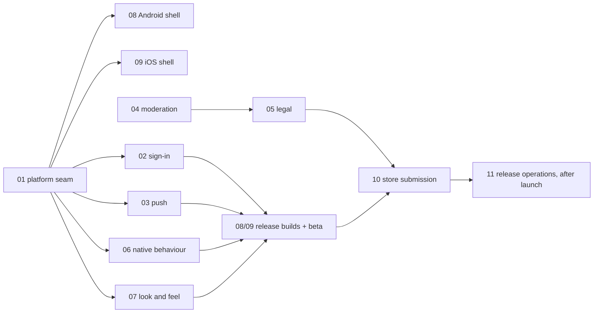

# Native apps (iOS and Android): the plan

**Status: not started.** Planned on 2026-11-25 against commit `c1f1083`. It is deliberately not for the 2026–27 playoffs (Wild Card January 16, 2027); it targets a later postseason. Nothing here has been built yet.

This folder is the hand-off for the session that picks the work up. It holds every decision made while planning, the reasons behind them, the facts they rest on (with the date each was checked), and one self-contained brief per piece of work. The owner's own steps (company, store accounts, dashboards) live in [docs/owner](../owner/README.md#native-apps-planned).

- [How to run this](#how-to-run-this)
- [Decisions](#decisions)
- [Architecture](#architecture)
- [Workstreams and order](#workstreams-and-order)
- [Gates](#gates)
- [Timeline](#timeline)
- [The off-season problem](#the-off-season-problem)
- [Facts this plan rests on](#facts-this-plan-rests-on)
- [Costs](#costs)
- [Risks](#risks)
- [Deliberately left out of v1](#deliberately-left-out-of-v1)

## How to run this

One **orchestrator** session runs the project. Each workstream is a **sub-session** in its own worktree that ends in its own branch and PR. **Subagents** are for research and review inside a session (re-verifying a fact, auditing a diff), never for owning a PR.

The orchestrator:

1. **Re-verifies the facts.** Months will have passed. Send a research subagent through [Facts this plan rests on](#facts-this-plan-rests-on) and each brief's "Re-verify before starting" list; correct this folder in a PR before any code is written.
2. **Checks the owner's progress** on the [gates](#gates). Engineering can start before the LLC exists, but nothing is submitted to a store until all three gates are closed.
3. **Creates child issues** under the epic, one per brief, and links each back to its file.
4. **Starts Phase A** (workstream 01 alone), then the two shell scaffolds.
5. **Starts Phase B** in parallel: one sub-session per brief, with the brief as its prompt. Each brief lists the files it touches; two sessions never write the same files at once, and where briefs overlap (noted in each "Touches") the orchestrator merges one before starting the other, or tells the second to rebase.
6. **Merges serially.** Sub-sessions cannot merge their own PRs; the orchestrator squash-merges each once required CI is green, then has the remaining sessions rebase.
7. **Keeps this folder true.** When a decision changes, edit [Decisions](#decisions) in the same PR. Tick the workstream table as PRs land.

Rules for every workstream, on top of [AGENTS.md](../../AGENTS.md):

- **The web app must not change** unless a brief says so. Every native difference goes through `frontend/src/utils/platform.ts` (workstream 01). A web build never imports a native plugin at module top level in a way that breaks the web; plugins are imported lazily or behind `isNative()`.
- The repo's existing gates still apply: new routes get their line in `api/tests/authz_expectations.py`; model or migration changes update `docs/erd.md`; UI changes on League, Team, Draft, Feed, layout, theme or recap screens run `make tour`; key-page changes need new quality baselines; e2e selectors you affect are run before the PR; mobile-first visual check at 375px.
- Native behaviour is checked on a real device or emulator, not only in the browser: the Android phone over USB (Chrome's `chrome://inspect` works from Linux) and the iPhone through TestFlight or the Mac's Safari Web Inspector.

## Decisions

Made with the owner on 2026-11-24 and 2026-11-25.

| Area | Decision | Why |
| :--- | :--- | :--- |
| Timing | Not the 2026–27 playoffs. The timeline is anchored to **Wild Card weekend (W)**, not calendar dates, so it fits whichever postseason the work targets. | Owner's choice; leaves room for the LLC, a beta and store review. |
| Approach | **Capacitor**, with the web build **bundled** into the app (not a shell that loads the live site). One React codebase builds the web app, the iOS app and the Android app. | Keeps MUI, React Router, the e2e suite and the tour. A remote-URL shell invites Apple 4.2 rejections, has no offline shell, and Google blocks sign-in inside it. A React Native or Swift/Kotlin rewrite would mean two UIs. |
| Updates | **No over-the-air JavaScript updates in v1.** A fix reaches phones through the stores (in the store next day, on most phones in 2–3 days; see [11](workstreams/11-release-operations.md)). Emergencies are covered by server-side kill switches and the web app. | Avoids another service and release path. First upgrade to revisit after a season. |
| Launch | Public in both stores about **W−6 weeks**. If App Review has not approved by **W−2**, that postseason runs on the beta channels (TestFlight builds last 90 days). Native builds **freeze at W−1** (draft week). | Members install before drafts; a stalled review never blocks the season. |
| Beta | Friends, family and league members, **invited by email**: TestFlight for iPhone, Play's internal testing track for Android. About 4 weeks, at least 5 people per platform. | Email invites keep control; a public link can be forwarded. |
| Countries | **United States only** at launch. Canada is the first candidate to add. Stated in the Privacy Policy and Terms. | Releasing in the EU needs a Digital Services Act trader declaration (published address and phone). |
| Company | One **umbrella LLC** owns both developer accounts and any later products; a product can be spun into its own LLC later. Formed at least 3 months before the target launch. Name ideas in [owner step 25](../owner/25-llc.md). | An organization account shows the company, not the owner's name, as seller, skips Google's 12-tester rule, and the LLC limits personal liability. |
| App identity | App ID **`com.postsznfantasy.app`** (permanent). Store name "PostSzn Fantasy", home-screen name "PostSzn". | Based on the product's domain, so it survives an LLC rename or a transfer. |
| Sign-in | Google, emailed code **and Sign in with Apple**, on all three platforms. Existing members can link Apple to their account from the account center. | Apple 4.8 requires an Apple-style option once Google is offered. Apple on iOS only would strand iPhone sign-ups on the web and Android. |
| Push | **Firebase Cloud Messaging** for both platforms; the API sends every native notification to Firebase, which delivers to Android and forwards to Apple. Web push stays as is for browsers. | One sender instead of two. |
| Moderation | Report a message, report a picture, report and block a member; a zero-tolerance community clause accepted at first sign-in; reports emailed to support; a promise to act within 24 hours. **Ships on the web too.** | Apple 1.2 and Google's user-generated-content policy require reporting and blocking. |
| Legal | The Privacy Policy and Terms are rewritten (LLC as operator, US only, every data processor, push tokens, community rules, deletion, age 13+), then **reviewed by a lawyer** before public launch. A public `/delete-account` page is added. | Store requirements, and the LLC's protection depends on sound paperwork. |
| Native differences | Native builds have **no** donation row, **no** team logos unless the rights check clears (a server flag, so clearing needs no release), **no** cached offline data, **no** service worker, **no** install prompts. | Apple 3.1.1 treats developer tips as in-app purchases; logo and data rights are unverified; the rest is web-only machinery. |
| Store reviewers | The Apple or Google reviewer signs in with **their own** Apple or Google account and joins a **demo league** with an invite code given in the review notes. An owner runbook resets the league after each review. | No hidden password login (Apple rejects "hidden features"), no fragile demo Google account. |
| Builds | **CI builds and uploads every release** (GitHub's macOS runners are free for this public repo). The owner's Mac (a 2012 MacBook Pro on a patched current macOS, slow) is the **debugging bench**: first-time Xcode signing setup, Safari Web Inspector, the occasional simulator check. | Reproducible builds; a patched Mac can break after an update. |
| Test devices | The owner's Android phone; the owner's wife's iPhone. | Real devices on both platforms. |
| After launch | The web's install prompts point to the App Store and Play Store; the Home Screen web app stays for desktop. Existing Home Screen users get a one-time "the app is here" notice. | Avoids two installs and duplicate notifications on one phone. |
| Owner steps | Numbered steps in [docs/owner](../owner/README.md#native-apps-planned) in the existing step-and-verify format (25 to 31), plus three runbooks. | Same place and shape as every other owner task. |
| Execution | One orchestrator, one sub-session per workstream, subagents for research and review. This folder plus one epic issue; child issues only when work starts. | Each workstream ends in a PR the owner wants to review; issues filed months ahead go stale. |

## Architecture

```
frontend/src (React, TypeScript)
   │  vite build
   ▼
frontend/dist ──────────────▶ Cloudflare Pages (the web app, as today)
   │  npx cap sync
   ├──▶ frontend/android  (Gradle project, thin Kotlin shell, WebView) ──▶ .aab ──▶ Google Play
   └──▶ frontend/ios      (Xcode project, thin Swift shell, WKWebView)  ──▶ .ipa ──▶ App Store
```

- Nothing is compiled to Swift or Kotlin. The same JavaScript runs in a WebView inside each shell; Capacitor plugins expose native features (push, haptics, share, files, sign-in) to it.
- `frontend/ios` and `frontend/android` are committed. They are mostly generated; the hand-written parts are small (entitlements, `Info.plist` strings, Gradle and plugin configuration, app icons and splash).
- **Stays as is:** the whole FastAPI backend, Postgres, scoring, ingestion, the scheduler, the WebSockets (they authenticate with an `AUTH` message and do not check the Origin header, so a native origin needs no change), React Query, the UI, Playwright against the web build, web deploys on every push to `main`.
- **Changes:** see the workstreams. In short: one platform seam, public links built from a fixed origin, three sign-in methods, a second push transport, moderation, legal pages, native replacements for downloads, links and install/update machinery, safe areas and native feel, two shells with CI, store paperwork, and a release process that copes with old app versions in the wild.

## Workstreams and order

| # | Brief | Phase | Needs | Status |
| :--- | :--- | :--- | :--- | :--- |
| 01 | [Platform seam and native build config](workstreams/01-platform-seam.md) | A | nothing | not started |
| 08 | [Android shell and CI](workstreams/08-android-shell.md) | A (scaffold), C (release) | 01 | not started |
| 09 | [iOS shell and CI](workstreams/09-ios-shell.md) | A (scaffold), C (release) | 01, owner steps 26 | not started |
| 02 | [Sign-in: Apple everywhere, native Google, linking](workstreams/02-sign-in.md) | B | 01, owner step 28 | not started |
| 03 | [Native push through Firebase](workstreams/03-push.md) | B | 01, owner step 27 | not started |
| 04 | [Moderation: report, block, community rules](workstreams/04-moderation.md) | B | nothing (web feature) | not started |
| 05 | [Privacy Policy, Terms, delete-account page](workstreams/05-legal.md) | B | 04 (rule names), LLC name | not started |
| 06 | [Native behaviour: links, files, updates, deep links, kill switches](workstreams/06-native-behaviour.md) | B | 01 | not started |
| 07 | [Native look and feel](workstreams/07-look-and-feel.md) | B | 01 | not started |
| 10 | [Store submission](workstreams/10-store-submission.md) | D | everything above, all gates | not started |
| 11 | [Release operations](workstreams/11-release-operations.md) | B (runbooks, metrics), E (after launch) | 01, 08, 09 | not started |



- **Phase A:** 01, then the shell scaffolds (08, 09) so every later workstream can be tried on a real phone.
- **Phase B (parallel):** 02, 03, 04, 05, 06, 07, and the runbook half of 11.
- **Phase C:** shells finished (signing, icons, release CI), beta.
- **Phase D:** store submission (10).
- **Phase E:** the post-launch half of 11.

Known overlaps between parallel briefs (merge one first, rebase the other): 02 and 03 both touch sign-out in `UserContext.tsx`; 03 and 04 both touch `api/services/push.py` (04 only filters recipients); 06 and 07 both touch `DraftPage.tsx` and `draftCue.ts`.

## Gates

Nothing is submitted for public release until all three are closed. Each is an owner step.

1. **LLC and store accounts exist** ([25](../owner/25-llc.md), [26](../owner/26-store-accounts.md)). Engineering can start before this, but the beta needs the organization accounts too: the plan never enrolls under the owner's personal name.
2. **Rights check** ([29](../owner/29-rights-check.md)): Tank01's terms allow a free commercial app, and a decision on team logos.
3. **Lawyer review** of the rewritten Privacy Policy and Terms ([30](../owner/30-legal-review.md)).

## Timeline

W is Wild Card Saturday. Weeks are rough; the order matters more than the exact week.

| When | What |
| :--- | :--- |
| W−30 or earlier | Go decision. Owner starts the LLC ([25](../owner/25-llc.md)); D-U-N-S alone can take about 30 days. |
| W−24 | Owner: store accounts ([26](../owner/26-store-accounts.md)), Firebase ([27](../owner/27-firebase-push.md)), Apple sign-in setup ([28](../owner/28-apple-sign-in.md)); starts the rights check ([29](../owner/29-rights-check.md)). |
| W−22 | Phase A: 01 merged; shell scaffolds (08, 09). |
| W−20 to W−14 | Phase B in parallel. |
| W−16 | **Wake the API early** (see [the off-season problem](#the-off-season-problem)). |
| W−14 | Legal draft (05) goes to the lawyer ([30](../owner/30-legal-review.md)). |
| W−13 | Phase C: signed release builds from CI. |
| W−12 to W−8 | Beta, fixes. |
| W−9 | All gates closed. |
| W−8 | Submit to both stores ([31](../owner/31-store-submission.md)). |
| W−6 | Target: public. Web install prompts switch to the stores (11). |
| W−2 | Fallback: if not approved, invite every league member to the beta channels. A TestFlight build uploaded now lasts past the Super Bowl. |
| W−1 | Native freeze. Hotfixes only through [the runbook](../owner/mobile-hotfix.md). |
| Super Bowl + 2 weeks | Retro. Decide on over-the-air updates. Update this folder. |

## The off-season problem

The [shutdown runbook](../deploy/shutdown-runbook.md) stops the Fly machine about a month after the Super Bowl, and the [wake-up runbook](../deploy/wake-up-runbook.md) starts it about a month before Wild Card. Native apps change that:

- **The beta and store review need a live API** from about W−16, earlier than the wake-up runbook's W−4. Wake the app tier early (Fly machine, Supabase active, `SEASON_YEAR` for the coming postseason); the scheduler and the paid Tank01 plan stay off until the wake-up runbook says otherwise. Update the wake-up runbook when this starts.
- **Installed apps outlive the season.** A native build cannot be rebuilt with `VITE_DORMANT=true`, so it reads the dormant flag at runtime from `https://postsznfantasy.com/status.json`, which Cloudflare Pages keeps serving while the API is stopped (workstream 06).
- **Never submit an update while the API is dormant.** The reviewer would see the dormant page and reject the app as not working.

## Facts this plan rests on

Checked on 2026-11-24 and 2026-11-25. Re-verify every row before starting; store rules change every year.

| Fact | Source |
| :--- | :--- |
| Apple: uploads must be built with Xcode 26 and the iOS 26 SDK or later (since April 2026). Expect the next major each spring. | [Apple upcoming requirements](https://developer.apple.com/news/upcoming-requirements/) |
| Xcode 26 needs macOS Sequoia 15.6 or later. | [Xcode system requirements](https://developer.apple.com/xcode/system-requirements) |
| Google Play: new apps and updates must target Android 16 (API 36) since August 31, 2026. Expect a new level each August. | [Play target API](https://support.google.com/googleplay/android-developer/answer/11926878) |
| Google Play: personal accounts created after November 13, 2023 need 12 testers opted in for 14 continuous days before production. Organization accounts are exempt but need a D-U-N-S number. | [Play testing requirements](https://support.google.com/googleplay/android-developer/answer/14151465) |
| Google Play: apps with accounts must offer deletion in the app and through a web link that works without the app; the link goes in the Data safety form. | [Play account deletion](https://support.google.com/googleplay/android-developer/answer/13327111) |
| Apple 4.2: apps that feel like a repackaged website are rejected for minimum functionality; native features are the defence. | [App Review Guidelines](https://developer.apple.com/app-store/review/guidelines/) |
| Apple 4.8: an app offering a third-party login must also offer a privacy-focused one (Sign in with Apple qualifies). | [App Review Guidelines](https://developer.apple.com/app-store/review/guidelines/) |
| Apple 1.2: apps with user-generated content need filtering, reporting, blocking and published contact information. | [App Review Guidelines](https://developer.apple.com/app-store/review/guidelines/) |
| Apple 3.1.1: tips to the developer go through in-app purchase, so the Buy Me a Coffee link is hidden in native builds. | [App Review Guidelines](https://developer.apple.com/app-store/review/guidelines/) |
| Apple review needs a working demo path; reviewers cannot receive the emailed code. | [App Review](https://developer.apple.com/distribute/app-review) |
| TestFlight: up to 10,000 external testers; the first build needs TestFlight App Review; each build lasts 90 days. | [TestFlight overview](https://developer.apple.com/help/app-store-connect/test-a-beta-version/overview-of-testflight/), [invite external testers](https://developer.apple.com/help/app-store-connect/test-a-beta-version/invite-external-testers) |
| Supabase Sign in with Apple: native iOS uses `signInWithIdToken` and needs no client secret; the web and Android OAuth flow needs a client secret that Apple makes you regenerate every 6 months. The Services ID must be listed first among Client IDs. | [Supabase: Sign in with Apple](https://supabase.com/docs/guides/auth/social-login/auth-apple) |
| CocoaPods' central registry goes read-only around December 2, 2026: use Swift Package Manager for the iOS project. | [Capawesome March 2026 update](https://capawesome.io/blog/2026-march-update/) |
| Capacitor's current major was 8.x (not confirmed). The official push plugin returns an APNs token on iOS, not a Firebase token; the community `@capacitor-firebase/messaging` plugin returns a Firebase token on both. | [Capacitor push docs](https://capacitorjs.com/docs/next/apis/push-notifications) |
| Tank01's terms of use could not be found online; NFL.com's own terms limit its data to non-commercial use. Unresolved: owner step 29. | [NFL.com terms](https://www.nfl.com/help/terms) |
| This repo is public, so GitHub-hosted macOS runners cost nothing. | `gh repo view` |
| The 2026 season's postseason: Wild Card January 16–18, 2027; Super Bowl LXI February 14, 2027. | [NFL schedule release](https://www.nfl.com/news/nfl-reveals-2026-wild-card-weekend-schedule) |

## Costs

- Apple Developer Program: $99 a year. Google Play: $25 once.
- LLC: state filing and annual fees (vary by state, roughly $50 to $500 a year), optional registered agent, a domain for the company (about $15 a year).
- Lawyer review: a one-time flat fee; get a quote first.
- Firebase Cloud Messaging: free. GitHub macOS runners: free for this public repo.
- Fly machine awake about three extra months a year: about $7 a month.

## Risks

| Risk | Mitigation |
| :--- | :--- |
| Apple rejects the app as a website wrapper (4.2). | Native push, Sign in with Apple, haptics, native share and files, universal links, keep-awake in the draft room. Review notes point the reviewer at them. |
| Store review is slow or rejects close to the season. | Submit at W−8, fallback at W−2 to the beta channels, freeze at W−1. |
| A bug ships in a store build mid-season. | Kill switches (06), the web app, [the hotfix runbook](../owner/mobile-hotfix.md), per-platform minimum versions (11). |
| Old app versions call changed endpoints. | Endpoints are deprecated for at least 30 days before removal; app-version metrics decide when a minimum can rise (11). |
| A member ends up with two accounts (Apple "Hide My Email" next to an existing Google or code account). | Account linking in the account center and sign-in copy (02). |
| Duplicate notifications on one phone (Home Screen web app plus native app). | The native app offers to remove that phone's web subscriptions (03), and the web stops offering phone installs after launch (11). |
| Apple sign-in breaks on the web and Android after 6 months. | Rotation script, runbook, calendar reminder ([apple-secret-rotation](../owner/apple-secret-rotation.md)). |
| Signing keys leak from the public repo's CI. | Release workflows run only on owner-pushed tags in a protected environment; forked PRs never see secrets; nothing secret is committed. |
| The patched Mac stops running Xcode. | It is never on the release path; CI builds everything. |
| Team logos or Tank01 data are not cleared for an app. | Logos off in native by default behind a server flag; licensed feeds (Sportradar, Goalserve) as the fallback if Tank01 says no. |

## Deliberately left out of v1

Over-the-air updates, offline data in native, home-screen quick actions (the manifest shortcuts), app icon badges, home-screen widgets, a Live Activity for the draft clock, tablet-specific layouts, in-app purchases or tips, countries other than the US, an in-app review prompt. Each is a reasonable follow-up once v1 is out.
